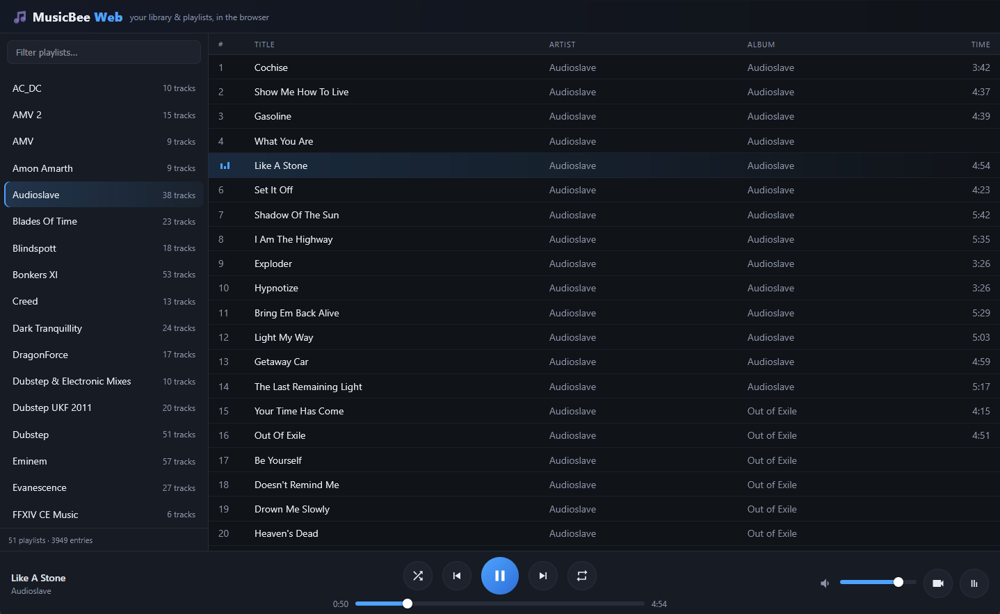

# MusicBee Web

A small web player that lets you listen to your **existing MusicBee library and
playlists** from any browser. It reads your MusicBee data files directly and
**never modifies them**, so it's safe to run while MusicBee is open.

> **Disclaimer:** This is a **personal project**, written with AI assistance under human guidance. It is free for anyone to use at no cost, but it is provided **"as is"** without any warranty of any kind. The author takes no responsibility for this software or for anything that happens while using it — including data loss, damage or security incidents. When running it, please apply best-practice security measures: bind to `127.0.0.1` while testing, use `AUTH_PASSWORD` (or a reverse proxy / Cloudflare) on shared networks, and never expose the server directly to the internet.

## Tested with

* MusicBee **3.6.9403** — Python **3.13.12**
* MusicBee **3.7.9796** — Python **3.15.2**

## What it uses

| File | Purpose |
|---|---|
| `<data_dir>\Playlists\*.mbp` | Your playlists (MusicBee native binary format, parsed directly) |
| `<data_dir>\MusicBeeLibrary.mbl` | Track durations (where available in the DB) |
| `<music root>\**` | The audio files themselves (streamed over HTTP with seek support) |

(Paths are auto-detected by default — see the CONFIGURATION block at the top
of `musicbee_web.py` to override them.)

## Run it

Double-click **Start MusicBee Web.bat**, then open **http://localhost:8321**
in your browser.

You can double-click it again at any time to restart — it automatically finds
and stops a previous instance that's still holding port 8321, so there's no
need to hunt for the process in Task Manager.

Or from a terminal:

The easiest way to change settings is the **CONFIGURATION** block near the top
of `musicbee_web.py` — it has `HOST`, `PORT`, `DATA_DIR`, `PLAYLISTS_DIR`,
`MUSIC_ROOTS` (a list, so you can include several music folders),
`ENFORCE_SAFE_DIRS` and optionally `AUTH_PASSWORD`. Any value left
empty/`None` is auto-detected.

You can also override any of them on the command line (CLI wins over config):

```bat
python musicbee_web.py                     :: uses the CONFIG section values
python musicbee_web.py --host 127.0.0.1    :: this PC only (overrides config)
python musicbee_web.py --port 9000         :: custom port (overrides config)
python musicbee_web.py --data-dir "C:\path\to\MusicBee" --playlists-dir "C:\path\to\Playlists" --music-root "D:\Music"
```

## Features

* All your normal `.mbp` playlists, plus a built-in **★ Full Library** view
  (every audio file under your Music folder)
* **Double-click** a track to play it (single click just selects/highlights)
* Play / pause / next / previous / shuffle / **repeat** (off → one → all),
  seek bar, volume, keyboard shortcuts (Space = play/pause, ←/→ = seek 10 s,
  Esc = hide video). The repeat mode is remembered across refreshes/restarts
* **Video playback** — MP4/M4V/WebM video tracks play in a stage
  overlay; close it with ✕ or Esc and the audio keeps playing. The video-camera
  button on the right toggles **audio-only mode**: videos keep playing, but the
  stage stays hidden (setting is remembered)
* **10-band equalizer** with presets (ROCK, POP, JAZZ, CLASSICAL, DANCE,
  BASS BOOST, LO-FI, VOCAL) — EQ button on the right of the player bar.
  Preset + fader positions are remembered across refreshes and restarts
* Auto-advance to the next track when one finishes (stops at the end of the
  playlist unless repeat-all is on)
* Tracks that moved are re-found automatically by file name (zero-padded track
  numbers ignored); genuinely missing files are shown dimmed with a ⚠
* Playlists refresh automatically when you change them in MusicBee
* Console stays clean: browsers constantly abort media connections (switching
  tracks, seeking, closing tabs) and the server swallows those harmless
  disconnects instead of printing scary tracebacks

## Limitations vs. desktop MusicBee

* **Smart/auto-playlists** (`.xautopf`, e.g. *25 Most Played*) can't be
  resolved outside MusicBee — they're listed but disabled.
* Browsers can play MP3, M4A/AAC, OGG/OPUS, FLAC, WAV and H.264/AAC MP4.
  **WMA/ape/mpc/wv** and most MKV/AVI files are listed with a warning but
  can't play (no browser codec).
* Some MP4 files use the old MPEG-4 Part 2 video codec (`mp4v`) which
  browsers can't decode — they'll be listed but may refuse to play.
  Re-encoding them once to H.264 (e.g. with ffmpeg) would fix that.
* No gapless playback, no tag editing — this is a player, not a replacement
  for the desktop app.
* Track durations show from your MusicBee DB where it has them; otherwise
  the duration appears once the track starts loading.

## Security note

By default the server binds to `0.0.0.0` (see the CONFIG section), so anyone
on your local network can reach it — fine at home, but don't expose it to the
internet without adding authentication. Two options:

* **Shared password** (built in): set `AUTH_PASSWORD = "yourpassword"` in the
  CONFIG section (or pass `--auth-password`). Browsers then show their standard
  login prompt before anything loads and remember it for the session, so you're
  prompted once. Note the prompt also asks for a **user name** — that field is
  ignored, anything goes; only the password matters (checked locally on this PC).
  This is basic shared-secret auth, not per-user accounts. For stronger security
  put a reverse proxy in front (e.g. nginx with proper authentication) — or better
  yet use **Cloudflare** (Tunnel + Access), which gives you real per-user logins
  and HTTPS.
* **Network-level**: put a tunnel like Tailscale in front of it for remote
  access, or set `HOST = "127.0.0.1"` (or pass `--host 127.0.0.1`) for
  this-PC-only access while testing.

The server is **read-only**: it only ever opens your files for reading — there
is no code path that writes, renames or deletes anything on disk, and the HTTP
layer only accepts GET requests (anything else is rejected).

It only serves files that live under your music root(s) or in a folder that
actually contains playlist tracks. Paths are resolved through symlinks/junctions
before that check, so a link inside your music folder can't be used to reach
files elsewhere — if you aggregate drives with a junction *inside* your music
folder, also add the target folder to `MUSIC_ROOTS`. With `ENFORCE_SAFE_DIRS`
on (the default) it refuses to start if a music root is a sensitive location
like `C:\`, a bare drive letter (`D:\`), `C:\Users` or a user profile folder,
since that would expose the rest of your files over the network. Set it to
`False` only if you really know what you're doing.

Responses also carry `X-Frame-Options: DENY` and `X-Content-Type-Options:
nosniff`, idle connections are released after 30 s, and full file paths are
redacted from the console request log.

## Screenshot


